# AWS Automated Threat Detection & Response

## Project Status

✅ Detection pipeline validated  
✅ Security posture finding investigated and remediated  
✅ Event-driven Lambda automation validated in `DRY_RUN` mode  
⚠️ Automated EC2 quarantine was designed but not executed before the temporary sandbox expired

---

## Project Overview

This project demonstrates a hands-on AWS Cloud Security Engineering workflow covering:

- Cloud audit logging
- Security posture management
- Threat detection
- Cloud incident investigation
- Event-driven security automation
- Response decision logic
- Security validation and observability

The project was built in a controlled AWS lab environment using Amazon EC2, AWS CloudTrail, Amazon GuardDuty, AWS Security Hub, Amazon EventBridge, AWS Lambda, IAM, Amazon CloudWatch, Amazon S3, and VPC Security Groups.

The main security scenario was:

> Detect a high-severity GuardDuty finding, route it through EventBridge, process the security event with Lambda, determine the appropriate response, and validate the automation through CloudWatch Logs.

---

## Architecture

```text
                     AWS Account
                         |
                         |
              +----------+----------+
              |                     |
              |                 AWS CloudTrail
              |                     |
              |                Audit Logging
              |                     |
              v                     v
         Amazon EC2            Amazon S3
         Workload
              |
              |
         Amazon GuardDuty
              |
              | High-Severity Finding
              v
       Amazon EventBridge
              |
              | Event Pattern
              v
          AWS Lambda
     cloudsec-guardduty-response
              |
              | Security Decision
              v
        Amazon CloudWatch
              |
              v
      Automation Validation


Security Posture Workflow

AWS Security Hub
       |
       v
CloudTrail.1 FAIL
       |
       v
Investigation
       |
       v
Multi-Region CloudTrail
Read + Write Management Events
Log File Validation
       |
       v
Remediated Configuration
```

---

## Security Objectives

The project was designed around several Cloud Security Engineer responsibilities:

1. Build a controlled EC2 workload.
2. Apply separate normal and quarantine network policies.
3. Investigate AWS API activity using CloudTrail.
4. Analyze GuardDuty threat findings.
5. Review Security Hub CSPM findings.
6. Remediate an AWS security control failure.
7. Route security events using EventBridge.
8. Process security findings using Python and Lambda.
9. Validate automated response decisions using CloudWatch.
10. Design a safe EC2 quarantine workflow.

---

## AWS Services Used

| AWS Service | Purpose |
|---|---|
| Amazon EC2 | Test workload |
| VPC Security Groups | Normal and quarantine network policies |
| AWS CloudTrail | API activity investigation and audit logging |
| Amazon S3 | CloudTrail log storage |
| Amazon GuardDuty | Threat detection |
| AWS Security Hub | Security posture management and CSPM |
| Amazon EventBridge | Security event filtering and routing |
| AWS Lambda | Automated security response logic |
| Amazon CloudWatch | Lambda execution and automation validation |
| AWS IAM | Service execution permissions |

---

# 1. EC2 Workload & Security Groups

A test EC2 workload was deployed inside the lab VPC.

Two Security Groups were prepared:

```text
cloudsec-workload-sg
```

Normal network policy for the EC2 workload.

```text
cloudsec-quarantine-sg
```

Restricted Security Group intended for automated containment.

The EC2 instance was configured without a public IPv4 address and with IMDSv2 required.

### Evidence

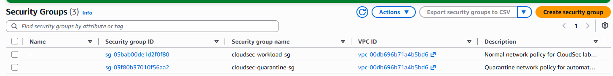

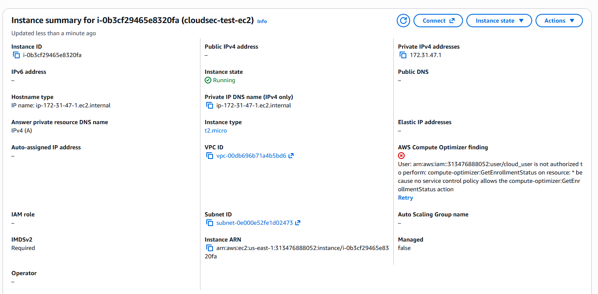

The quarantine architecture was intentionally prepared before implementing automatic containment.

---

# 2. CloudTrail Investigation

AWS CloudTrail was used to investigate the creation of the EC2 workload.

The investigated API event was:

```text
RunInstances
```

with:

```text
Event source: ec2.amazonaws.com
Read-only: false
Region: us-east-1
```

The event allowed the API request to be correlated with resources such as:

- EC2 instance
- VPC
- Subnet
- Security Group
- Network interface
- AMI

### Evidence


The `requestParameters` section was also investigated to understand what configuration was requested during EC2 creation.

Relevant values included:

```text
instanceType = t2.micro
associatePublicIpAddress = false
Security Group = cloudsec-workload-sg
```

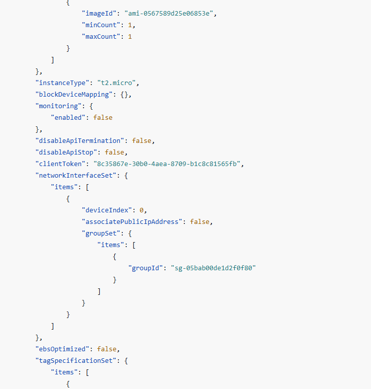

Detailed investigation:

[CloudTrail RunInstances Investigation](cloudtrail/runinstances-investigation.md)

---

# 3. GuardDuty Threat Detection

Amazon GuardDuty was enabled to provide threat detection capabilities.

AWS-generated sample findings were used to safely test the detection and automation workflow.

The selected finding was:

```text
Backdoor:Runtime/C&CActivity.B!DNS
```

Severity:

```text
HIGH
```

The finding represented a workload performing a DNS query for infrastructure associated with a known Command & Control server.

### Detection interpretation

A simplified attack scenario could be:

```text
Compromised workload
        |
        v
Malicious process
        |
        v
DNS request
        |
        v
Command & Control domain
```

### Evidence

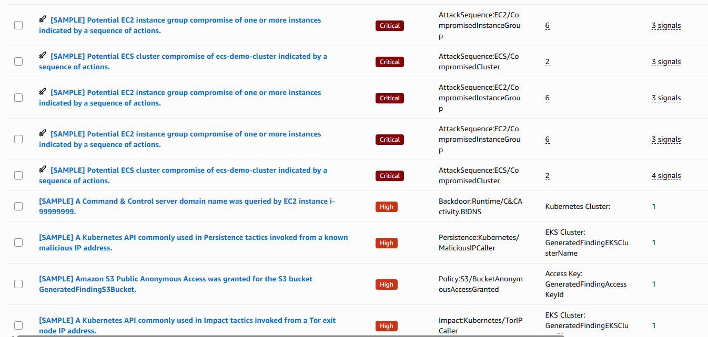

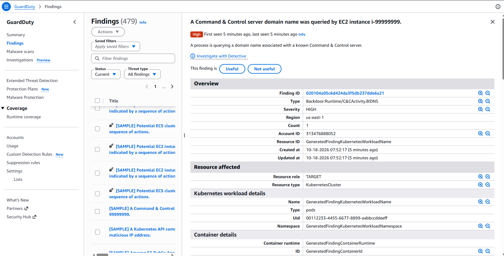

The technical investigation also identified:

```text
Action type: DNS_REQUEST
Protocol: UDP
Blocked: false
```

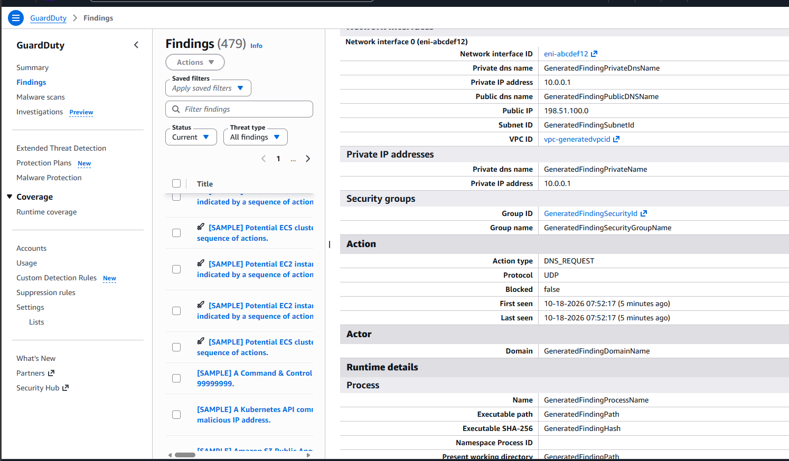

Detailed analysis:

[GuardDuty C2 Finding Analysis](guardduty/c2-finding-analysis.md)

---

# 4. Security Hub CSPM

AWS Security Hub was enabled to evaluate the security posture of the AWS environment.

Security Hub identified several configuration findings.

One high-severity finding was selected for investigation:

```text
CloudTrail should be enabled and configured with at least one
multi-Region trail that includes read and write management events
```

Control:

```text
CloudTrail.1
```

Initial compliance status:

```text
FAIL
```

### Evidence

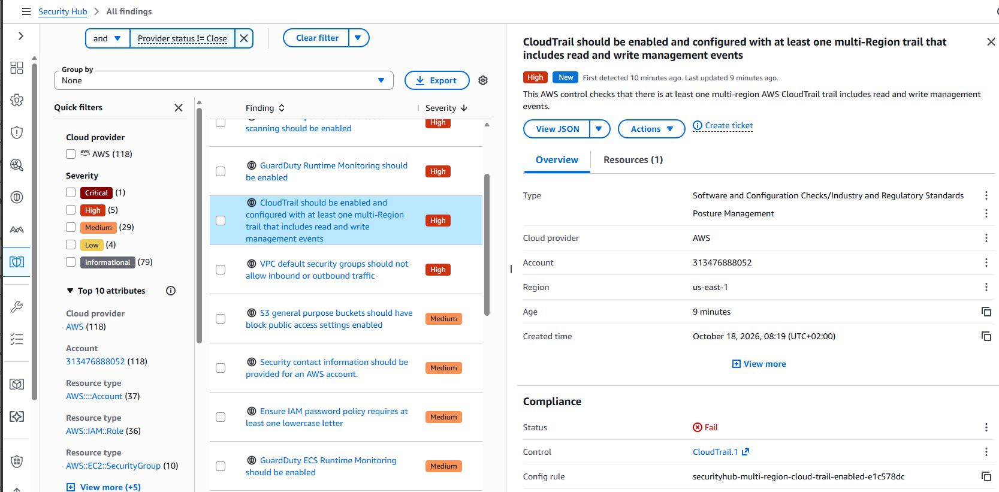

This demonstrated the difference between:

```text
GuardDuty
→ Threat Detection
```

and:

```text
Security Hub CSPM
→ Security Configuration / Posture Assessment
```

---

# 5. CloudTrail Remediation

Security Hub provided remediation guidance for the failed CloudTrail control.

The required configuration included:

```text
Multi-Region Trail
Management Events enabled
Read events enabled
Write events enabled
Log file validation enabled
```

### Evidence

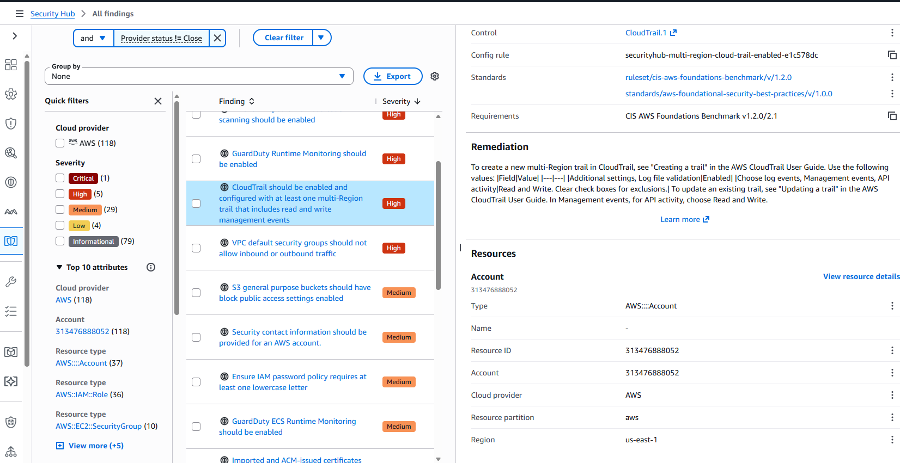

A new trail was configured:

```text
cloudsec-security-audit-trail
```

Management API activity was configured for:

```text
Read  = Enabled
Write = Enabled
```

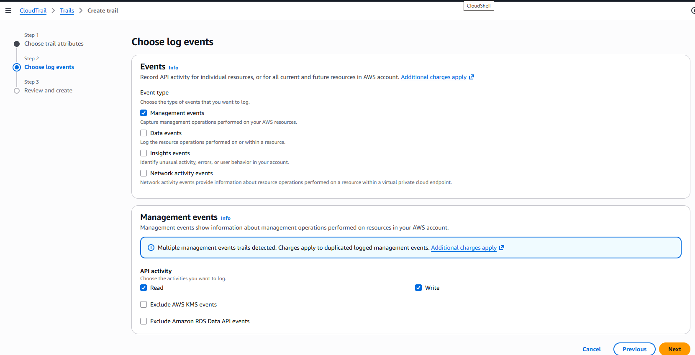

The final trail configuration included:

```text
Trail logging       = Logging
Multi-region trail  = Yes
Log file validation = Enabled
S3 log storage      = Configured
```

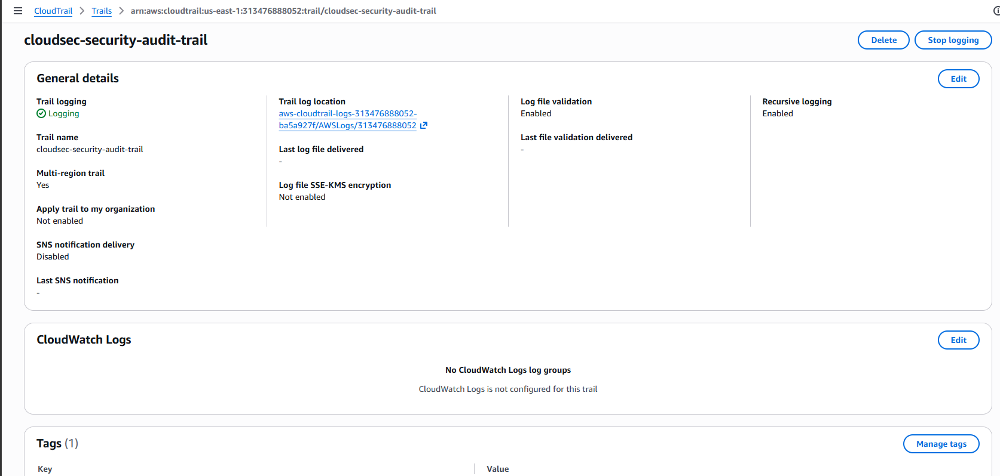

Detailed remediation analysis:

[Security Hub CloudTrail Remediation](security-hub/cloudtrail-control-remediation.md)

---

# 6. EventBridge Detection Routing

Amazon EventBridge was used to create the event-driven security automation layer.

The rule processes GuardDuty findings matching the required security criteria.

Example event pattern:

```json
{
  "source": ["aws.guardduty"],
  "detail-type": ["GuardDuty Finding"],
  "detail": {
    "severity": [
      {
        "numeric": [">=", 7]
      }
    ]
  }
}
```

This means:

```text
GuardDuty generates finding
        |
        v
EventBridge receives event
        |
        v
Severity >= 7 ?
        |
       Yes
        |
        v
Invoke Lambda
```

### Evidence

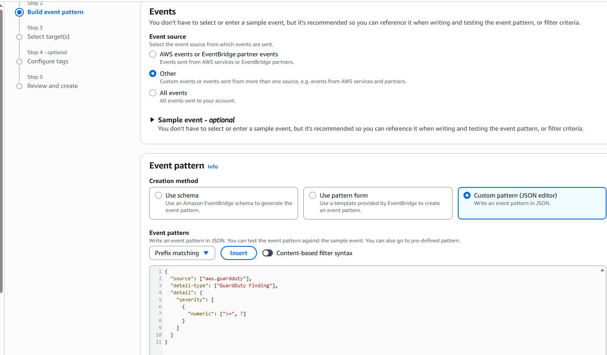

The complete event pattern is available here:

[GuardDuty High-Severity Event Pattern](eventbridge/guardduty-high-severity-pattern.json)

---

# 7. Lambda Response Automation

A Python Lambda function was created:

```text
cloudsec-guardduty-response
```

The function extracts security information from the GuardDuty event including:

```text
Finding Type
Severity
Instance ID
```

It then creates a security response decision.

During the lab, the function intentionally operated in:

```text
DRY_RUN
```

mode.

Example response:

```json
{
  "mode": "DRY_RUN",
  "findingType": "Backdoor:Runtime/C&CActivity.B!DNS",
  "severity": 8,
  "instanceId": "i-99999999",
  "recommendedAction": "QUARANTINE_INSTANCE"
}
```

The use of dry-run mode allowed the detection and automation pipeline to be validated before granting the function permissions to modify production infrastructure.

### Evidence

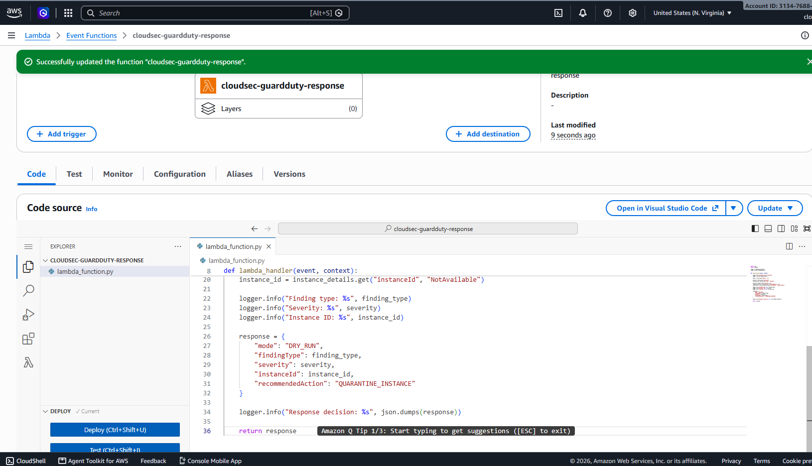

EventBridge was configured to invoke:

```text
cloudsec-guardduty-response
```

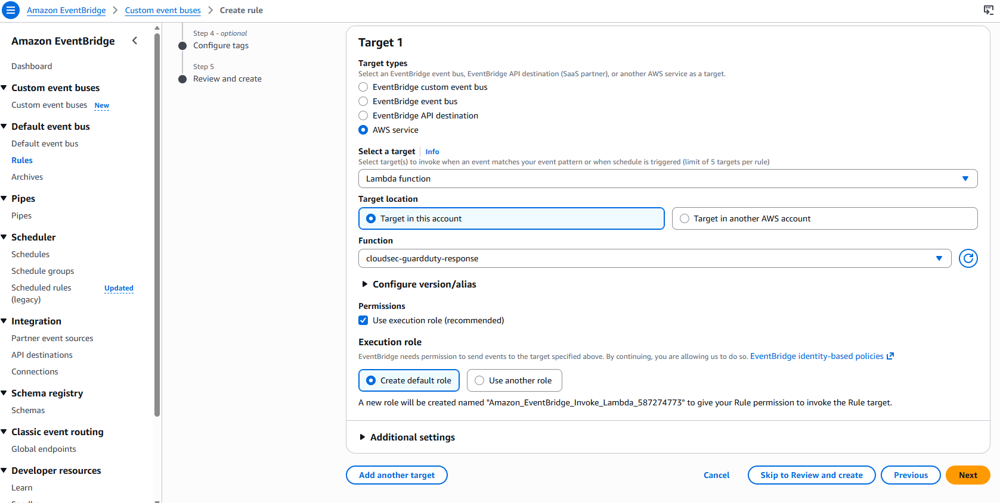

Lambda source code:

[GuardDuty Response Lambda](lambda/guardduty_response.py)

---

# 8. CloudWatch Validation

Amazon CloudWatch Logs was used to validate the final automation pipeline.

The logs confirmed that Lambda received GuardDuty events and successfully extracted the relevant security information.

Example execution:

```text
GuardDuty event received

Finding type:
Backdoor:Runtime/C&CActivity.B!DNS

Severity:
8

Instance ID:
i-99999999

Response decision:
DRY_RUN

Recommended Action:
QUARANTINE_INSTANCE
```

### Evidence

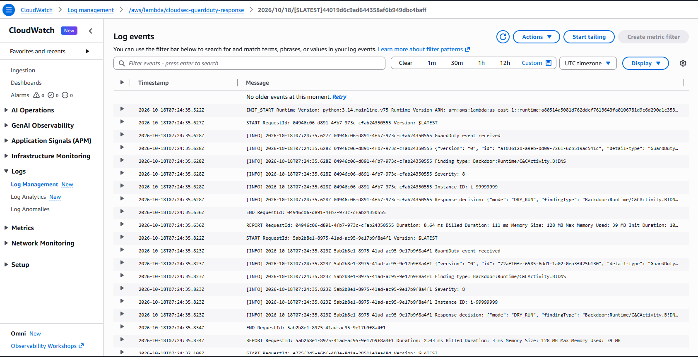

This confirmed the working pipeline:

```text
GuardDuty
    |
    v
EventBridge
    |
    v
Lambda
    |
    v
Security Decision
    |
    v
CloudWatch
```

Detailed validation:

[CloudWatch Automation Validation](cloudwatch/automation-validation.md)

---

# Incident Response Workflow

The project demonstrates the following Cloud Security Engineering response process:

```text
1. Detect
   |
   v
GuardDuty identifies suspicious activity

2. Filter
   |
   v
EventBridge evaluates finding attributes

3. Process
   |
   v
Lambda parses security context

4. Decide
   |
   v
QUARANTINE_INSTANCE

5. Validate
   |
   v
CloudWatch confirms execution

6. Contain
   |
   v
Replace workload Security Group
with quarantine Security Group
```

The final containment step was designed but intentionally not executed during this lab.

---

# Evidence

The repository contains screenshots documenting the main phases of the project:

```text
screenshots/
├── 01-security-groups.png
├── 02-ec2-workload.png
├── 03-cloudtrail-runinstances.png
├── 04-cloudtrail-request-parameters.png
├── 05-guardduty-findings-overview.png
├── 06-guardduty-c2-finding.png
├── 07-guardduty-c2-technical-details.png
├── 08-security-hub-cloudtrail-fail.png
├── 09-security-hub-remediation-guidance.png
├── 10-cloudtrail-management-events.png
├── 11-cloudtrail-remediation-details.png
├── 12-eventbridge-high-severity-pattern.png
├── 13-lambda-dry-run-response.png
├── 14-eventbridge-lambda-target.png
└── 15-cloudwatch-automation-validation.png
```

---

# Repository Structure

```text
aws-automated-threat-response/
│
├── cloudtrail/
│   └── runinstances-investigation.md
│
├── cloudwatch/
│   └── automation-validation.md
│
├── eventbridge/
│   └── guardduty-high-severity-pattern.json
│
├── guardduty/
│   └── c2-finding-analysis.md
│
├── lambda/
│   └── guardduty_response.py
│
├── security-hub/
│   └── cloudtrail-control-remediation.md
│
├── screenshots/
│   └── project evidence
│
├── .gitignore
└── README.md
```

---

# Security Considerations

Several security engineering principles were applied during the project:

- EC2 workload deployed without a public IPv4 address.
- IMDSv2 required for instance metadata access.
- Separate quarantine Security Group prepared before automation.
- High-severity findings filtered before invoking response logic.
- Automated containment tested in dry-run mode first.
- CloudWatch used to validate automation behavior.
- CloudTrail configured for multi-Region audit logging.
- Read and write management events enabled.
- CloudTrail log file validation enabled.
- Sensitive AWS identifiers were removed from public evidence where appropriate.

---

# Limitations

This project was completed in a temporary AWS training sandbox.

AWS-generated GuardDuty sample findings were used instead of intentionally compromising a real EC2 workload.

The following pipeline was successfully validated:

```text
GuardDuty
→ EventBridge
→ Lambda
→ DRY_RUN response decision
→ CloudWatch
```

The final infrastructure-changing action:

```text
Replace normal Security Group
        |
        v
Apply quarantine Security Group
```

was designed but not executed before the sandbox environment expired.

The repository therefore does not claim that real EC2 quarantine was performed.

---

# Skills Demonstrated

This project demonstrates practical experience with:

- AWS Cloud Security Engineering
- Amazon GuardDuty
- AWS Security Hub CSPM
- AWS CloudTrail
- Amazon EventBridge
- AWS Lambda
- Amazon CloudWatch
- IAM permissions
- EC2 security architecture
- VPC Security Groups
- Cloud incident investigation
- Threat detection
- Security posture assessment
- Event-driven automation
- Python security automation
- JSON event processing
- Incident response design
- Safe remediation testing
- Cloud security documentation

---

## Key Result

The project successfully demonstrated an event-driven AWS security workflow in which a high-severity GuardDuty finding was routed through EventBridge, processed by Lambda, converted into a quarantine recommendation, and validated through CloudWatch Logs.

The implementation intentionally separated **detection**, **decision**, and **remediation**, allowing automated response logic to be validated safely before infrastructure-changing permissions were introduced.
